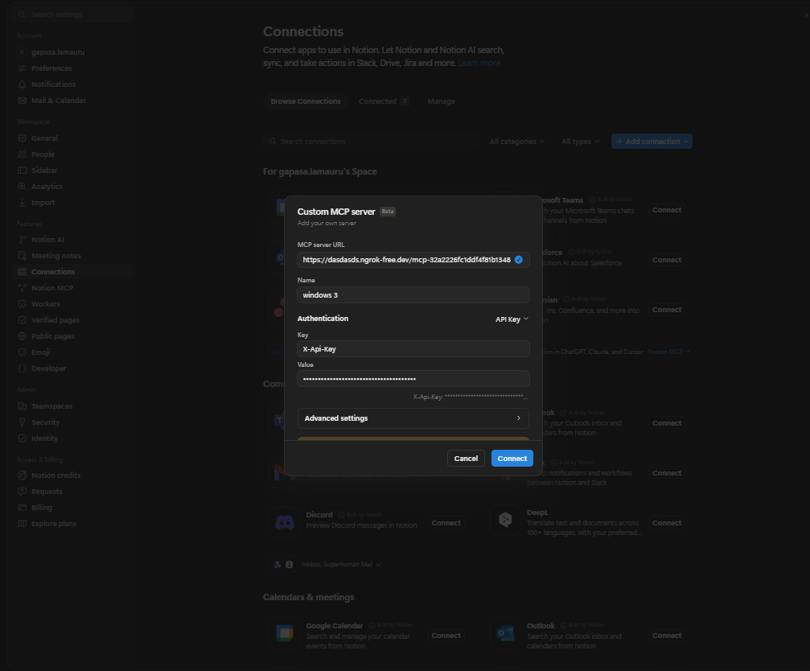

# Notion MCP

Доступ к файлам и терминалу вашего компьютера из Notion: **Notion → ngrok → mcp-proxy → Desktop Commander**. Работает в Windows, macOS и Linux.

> [!WARNING]
> **Полный доступ к компьютеру** в пределах прав вашей учётной записи. Обладатель URL и `X-Api-Key` сможет читать и изменять файлы и выполнять команды. Не запускайте мост от администратора или root и никому не передавайте ключи.

## Быстрый старт

Скачайте или клонируйте репозиторий в любую папку и выполните шаги по порядку:

| Шаг | Windows | macOS / Linux |
| --- | --- | --- |
| 1. Проверка и установка зависимостей | `install_dependencies.bat` | `./install_dependencies.sh` |
| 2. Ввод токена ngrok | `setup_notion.bat` | `./setup_notion.sh` |
| 3. Запуск: выводит URL и `X-Api-Key` | `start_notion.bat` | `./start_notion.sh` |
| Остановка | `stop_notion.bat` или Ctrl+C | `./stop_notion.sh` или Ctrl+C |

1. **Зависимости.** Нужны Python 3.10+, Node.js 22+, npm 9+ и ngrok 3.39+. Недостающее устанавливается только с вашего согласия: в Windows — через winget, в macOS и Linux — официальные сборки Node.js и ngrok скачиваются в папку `tools/` (без sudo и изменений системы).
2. **Токен.** Скопируйте [authtoken ngrok](https://dashboard.ngrok.com/get-started/your-authtoken) (бесплатного аккаунта достаточно) и вставьте его — токен виден на экране. Подойдёт и вся команда `ngrok config add-authtoken …`. Домен ngrok необязателен: Enter — назначить автоматически.
3. **Запуск.** Дождитесь статуса **РАБОТАЕТ** и оставьте окно открытым, пока пользуетесь подключением.

## Подключение к Notion

В Notion откройте **Settings → Connections → Add connection → Custom MCP server** и заполните форму:

| Поле | Значение |
| --- | --- |
| **MCP server URL** | Полный URL из окна запуска, включая `/mcp-…` |
| **Name** | Любое, например `My PC` |
| **Authentication** | `API Key` |
| **Key** | `X-Api-Key` |
| **Value** | Значение `X-Api-Key` из окна запуска |

Нажмите **Connect**. Ключ и секретный путь сохраняются между запусками: пока адрес ngrok тот же, подключать заново не нужно.



## Файлы и настройки

```text
config/config.json     ключ, секретный путь, порт, домен (создаётся на шаге 2)
config/ngrok.yml       токен ngrok (или переменная NGROK_AUTHTOKEN)
runtime/               логи и состояние запущенного моста
tools/                 Node.js и ngrok, скачанные установщиком (macOS/Linux)
```

- Секретные файлы не попадают в git. Не передавайте их другим.
- Если порт 8888 занят, мост выберет свободный. Второй запуск из той же папки не создаёт копию, а показывает данные первой.
- Мост включает полный доступ и выключает телеметрию в общем конфиге Desktop Commander `~/.claude-server-commander/config.json`. Перед первым изменением рядом сохраняется резервная копия.

## Диагностика

| Проблема | Решение |
| --- | --- |
| `ERR_NGROK_105`, `ERR_NGROK_107` | Неверный токен — повторите шаг 2 |
| `ERR_NGROK_108`, `ERR_NGROK_334` | Аккаунт или домен уже занят другим запущенным ngrok — остановите его |
| Ошибка зависимостей | Повторите шаг 1 |
| `Permission denied` в macOS/Linux | `chmod +x *.sh` |
| Notion не подключается | Окно запуска открыто, статус РАБОТАЕТ, URL скопирован целиком |

Проверка работающего моста (`--prove` дополнительно выполняет тестовую команду):

```bash
py -3 scripts\manage.py verify --prove      # Windows
python3 scripts/manage.py verify --prove    # macOS / Linux
```

Логи: `runtime/bridge.log`, `runtime/ngrok.log`, `runtime/launcher.log`.
