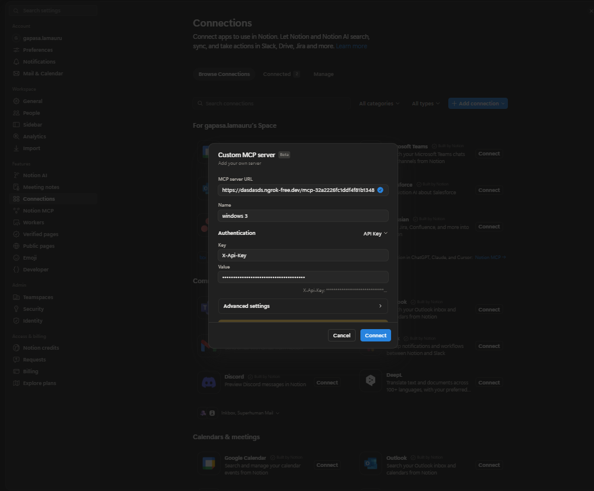

# Notion MCP

Доступ к файлам и терминалу Windows из Notion через **Desktop Commander → mcp-proxy → ngrok**.

> **Полный доступ к ПК в пределах прав пользователя Windows.** Обладатель URL и `X-Api-Key` сможет работать с файлами и выполнять команды. Не запускайте мост от администратора и не публикуйте ключи.

## Запуск

Скачайте или клонируйте репозиторий в любую папку и запускайте по порядку:

| Файл | Действие |
| --- | --- |
| `install_dependencies.bat` | Проверка всех зависимостей; установка недостающих с вашего согласия |
| `setup_notion.bat` | Настройка ngrok, создание MCP-ключа и секретного пути |
| `start_notion.bat` | Запуск сервера и вывод статуса, URL и `X-Api-Key` |
| `stop_notion.bat` | Остановка сервера этой папки; также доступен Ctrl+C |

Требуются **Python 3.10+, Node.js 22+, npm 9+, ngrok 3.39+** и аккаунт ngrok с authtoken. Pip-пакеты не нужны. Установщик проверяет весь npm-граф по lock-файлу; для установки системных компонентов использует winget.

При нескольких копиях ngrok установщик выбирает самую новую подходящую и сохраняет путь. Если winget не обновляет старую версию, предлагается `ngrok update`; явно заданный `ngrok_bin` не заменяется.

## Подключение к Notion

1. Запустите `start_notion.bat` и дождитесь статуса **РАБОТАЕТ**.
2. В Notion откройте **Settings → Connections → Add connection → Custom MCP server**.
3. Заполните форму:

   | Поле | Значение |
   | --- | --- |
   | **MCP server URL** | Полный URL из окна запуска, включая `/mcp-…` |
   | **Name** | Любое название, например `Windows` |
   | **Authentication** | `API Key` |
   | **Key** | `X-Api-Key` |
   | **Value** | Значение `X-Api-Key` из окна запуска |

4. Нажмите **Connect**.

На скриншоте — пример: используйте свой URL и ключ. Ngrok authtoken в эту форму вводить не нужно.



## Настройки и файлы

```text
config/                  конфигурация и локальные секреты
scripts/                 запуск и оформление консоли
src/notion_pc_bridge/    код моста
runtime/                 логи и состояние
```

Настройки создаются в `config/config.json`; образец — `config/config.example.json`. Токен ngrok хранится в `config/ngrok.yml` либо передаётся через `NGROK_AUTHTOKEN`.

Папка установки не ограничивает доступ к файлам ПК. Если порт 8888 занят, мост выбирает свободный, не останавливая чужие процессы. Повторный запуск из той же папки не создаёт второй экземпляр. Лимиты и конфликты доменов ngrok при этом сохраняются.

## Диагностика

```powershell
py -3 scripts/manage.py verify   # проверка уже работающего MCP-подключения
npm.cmd audit --omit=dev         # аудит npm-зависимостей
```

Логи: `runtime/bridge.log`, `runtime/ngrok.log`, `runtime/launcher.log`. При сбоях зависимостей повторите `install_dependencies.bat`; при ошибках туннеля проверьте токен, домен и лимиты ngrok.
